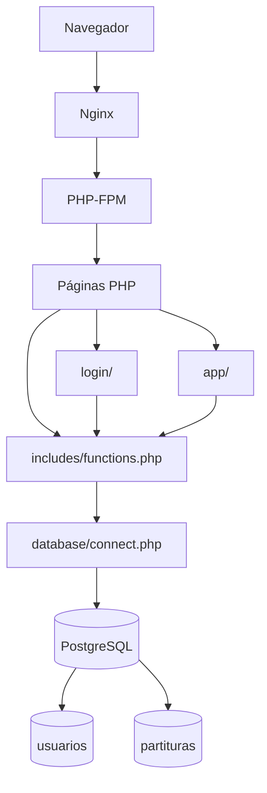
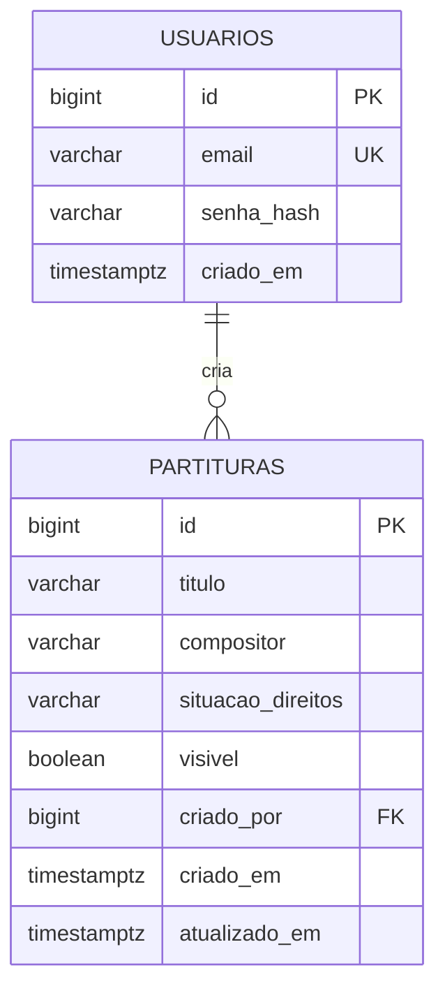
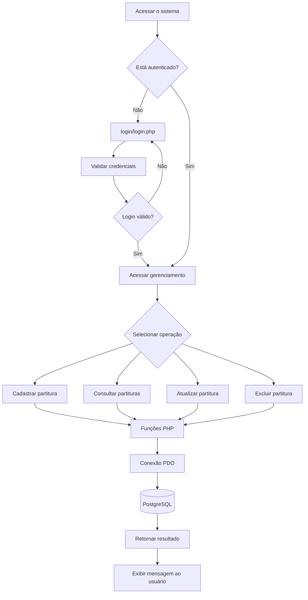
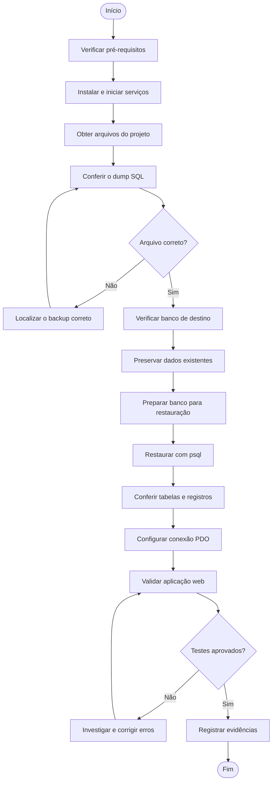

# 🎼 Acervo Digital de Partituras Brasileiras — Documentação Técnica e Procedimento de Restauração do Banco

## Sumário

1. Visão geral do projeto
2. Levantamento de requisitos
3. Arquitetura e fluxo do sistema
4. Processo de restauração do banco de dados
5. Fluxograma da restauração
6. Dependências e pré-requisitos
7. Configuração do banco de dados
8. Validação pós-restauração
9. Arquivos relacionados à restauração
10. Segurança
11. Rastreabilidade e evidências
12. Licença
13. Autor e repositório

# 1. Visão geral do projeto

## 1.1 Objetivo

O Acervo Digital de Partituras Brasileiras é uma aplicação web em PHP para cadastrar, organizar e consultar partituras, reunindo informações sobre títulos, compositores, ano de composição, gênero musical, instrumentação, tonalidade, descrição, procedência e situação dos direitos autorais.

O sistema utiliza PostgreSQL para armazenar os registros e oferece funcionalidades administrativas para cadastrar, consultar, atualizar e excluir partituras. A autenticação controla o acesso às páginas administrativas.

## 1.2 Tecnologias

| Camada | Tecnologia |
|---|---|
| Back-end | PHP |
| Acesso a dados | PDO |
| Banco de dados | PostgreSQL |
| Servidor web | Nginx |
| Processamento PHP | PHP-FPM |
| Front-end | HTML e CSS |
| Controle de versão | Git / GitHub |

## 1.3 Estrutura de diretórios

```text
acervo-partituras-brasileiras/
├── README.md
└── mini-sistema-main/
    ├── index.php
    ├── dump.sql
    ├── app/
    │   ├── create.php
    │   ├── delete.php
    │   ├── select.php
    │   ├── select_where.php
    │   └── update.php
    ├── database/
    │   ├── connect.php
    │   └── schema.sql
    ├── includes/
    │   ├── functions.php
    │   ├── header.php
    │   └── footer.php
    ├── login/
    │   ├── login.php
    │   ├── cadastrar.php
    │   ├── logout.php
    │   └── verifica_user.php
    ├── style/
    └── uploads/
```

O diretório `app/` reúne as páginas de gerenciamento de partituras. O diretório `login/` contém os arquivos de autenticação e controle de acesso. A pasta `includes/` concentra componentes compartilhados e funções reutilizáveis.

O arquivo `database/connect.php` estabelece a conexão com o PostgreSQL, enquanto `database/schema.sql` contém a estrutura das tabelas. O arquivo `dump.sql`, na raiz de `mini-sistema-main/`, corresponde ao dump SQL presente no repositório.

## 1.4 Arquitetura geral




## 1.5 Modelo de dados





# 2. Levantamento de requisitos

## 2.1 Requisitos funcionais

| ID | Requisito | Comportamento | Módulo | Evidência |
|---|---|---|---|---|
| RF01 | Autenticação de usuário | Permite cadastrar usuário, entrar e sair do sistema | `login/` | Sessões e validação de acesso |
| RF02 | Proteção administrativa | Bloqueia páginas protegidas quando não existe sessão válida | `login/verifica_user.php` | Verificação de `$_SESSION['id']` |
| RF03 | Cadastrar partitura | Registra título, compositor e metadados musicais | `app/create.php` | Funções em `includes/functions.php` |
| RF04 | Consultar e listar partituras | Permite consultar registros cadastrados | `app/select.php`, `app/select_where.php` | Consultas ao PostgreSQL |
| RF05 | Atualizar partitura | Modifica os dados de uma partitura existente | `app/update.php` | Operação de atualização |
| RF06 | Excluir partitura | Remove um registro identificado | `app/delete.php` | Operação de exclusão |
| RF07 | Registrar direitos | Armazena a situação dos direitos e informações de licença | Páginas de cadastro e edição | Campo `situacao_direitos` |
| RF08 | Registrar procedência | Permite informar a fonte da partitura | `app/create.php` | Campo `fonte_procedencia` |
| RF09 | Controlar visibilidade | Registra se uma partitura está visível | Formulários e banco de dados | Campo `visivel` |
| RF10 | Encerrar sessão | Limpa a sessão e encerra a autenticação | `login/logout.php` | `session_destroy()` |

## 2.2 Requisitos de backup e restauração

| ID | Requisito | Origem |
|---|---|---|
| RB01 | O backup pode ser gerado com `pg_dump` em formato SQL puro do banco `acervo` | Procedimento de backup |
| RB02 | O dump presente no repositório chama-se `dump.sql` e está na raiz de `mini-sistema-main/` | Repositório GitHub |
| RB03 | A restauração utiliza `psql` com um banco PostgreSQL previamente criado | Procedimento de restauração |
| RB04 | Os parâmetros de conexão devem corresponder ao ambiente | `database/connect.php` |
| RB05 | O ambiente precisa de Git, PostgreSQL, PHP, PHP-FPM e do driver PDO para PostgreSQL | Dependências da aplicação |
| RB06 | O diretório de implantação utilizado no servidor é `/var/www/html/acervo-sistema/mini-sistema-main/` | Ambiente de implantação |

## 2.3 Requisitos não funcionais

| ID | Título | Descrição |
|---|---|---|
| RNF01 | Tecnologias base | PHP e PostgreSQL |
| RNF02 | Acesso ao banco | PDO por meio de `database/connect.php` |
| RNF03 | Compatibilidade web | Navegadores modernos |
| RNF04 | Proteção contra SQL Injection | Utilizar consultas parametrizadas |
| RNF05 | Sessões e autenticação | Sessões PHP e encerramento no logout |
| RNF06 | Integridade dos dados | Chaves primárias, restrições e referências entre tabelas |
| RNF07 | Controle de acesso | Verificação de sessão nas páginas protegidas |
| RNF08 | Organização do código | Separação entre páginas, funções e conexão |
| RNF09 | Interface | Formulários de cadastro e gerenciamento |
| RNF10 | Manutenção | Código organizado em diretórios específicos |
| RNF11 | Feedback ao usuário | Mensagens de sucesso e erro nas operações |
| RNF12 | Recuperação de dados | Backup SQL e procedimento de restauração |

# 3. Arquitetura e fluxo do sistema

## 3.1 Acesso ao banco e controle de acesso

A aplicação utiliza `database/connect.php` para estabelecer a conexão com o PostgreSQL. As funções de acesso aos dados estão centralizadas em `includes/functions.php`.

As páginas protegidas verificam a existência de uma sessão válida por meio de `login/verifica_user.php`. Quando o usuário não está autenticado, o acesso é redirecionado para a página de login.

## 3.2 Autenticação e gerenciamento de partituras





## 3.3 Backup

O backup do banco PostgreSQL foi gerado utilizando `pg_dump`, com saída em formato SQL puro.

O comando utilizado foi:

```bash
pg_dump -U postgres -h localhost -p 5432 -F p -b -v -f acervo.sql acervo
```

O arquivo `acervo.sql` foi salvo inicialmente no diretório de trabalho do comando no servidor. Posteriormente, foi identificada uma cópia local no Windows.

No repositório GitHub, o arquivo de dump presente no projeto chama-se `dump.sql` e está na raiz de `mini-sistema-main/`.

Os nomes correspondem a arquivos em locais distintos. Antes de restaurar o banco, confirme qual arquivo será utilizado e se ele contém o backup pretendido.

# 4. Processo de restauração do banco de dados

Este procedimento descreve como preparar o ambiente e restaurar um dump SQL do Acervo Digital de Partituras Brasileiras.

Pré-requisitos: Linux com `apt`, usuário com permissão `sudo`, acesso ao repositório e acesso administrativo ao PostgreSQL.

## 4.1 Instalar e iniciar os serviços

```bash
sudo apt update
sudo apt install git nginx php-fpm php-pgsql postgresql postgresql-contrib -y
sudo systemctl start postgresql nginx
```

Confira a versão do PHP e as extensões necessárias:

```bash
php -v
php -m | grep -i pgsql
sudo systemctl status postgresql
sudo systemctl status nginx
```

O PHP precisa estar disponível com suporte ao PostgreSQL. O Nginx encaminha as requisições PHP ao PHP-FPM.

Se o Apache estiver instalado e estiver ocupando a porta 80, verifique a configuração antes de interrompê-lo.

## 4.2 Baixar o projeto

Repositório utilizado:

https://github.com/cauepasilva-art/acervo-partituras-brasileiras

Para uma instalação nova, clone o repositório no diretório de implantação:

```bash
cd /var/www/html
sudo git clone https://github.com/cauepasilva-art/acervo-partituras-brasileiras.git acervo-sistema
cd /var/www/html/acervo-partituras-brasileiras/mini-sistema-main
```

Se o projeto já estiver instalado, não execute o clone sobre uma pasta existente. Confira os arquivos presentes e atualize-os conforme o procedimento adotado no servidor.

Confira os arquivos:

```bash
ls -lh
ls -lh database/
```

Para localizar instruções de criação de tabelas no dump:

```bash
grep -n "CREATE TABLE" dump.sql
```

## 4.3 Verificar o banco de dados

O banco utilizado no ambiente atual chama-se `acervo`.

Antes de criar tabelas ou restaurar dados, verifique se o banco já existe e se contém informações que precisam ser preservadas.

Para acessar o PostgreSQL:

```bash
sudo -u postgres psql
```

No terminal do PostgreSQL, consulte os bancos disponíveis:

```sql
\l
```

Saia do terminal com:

```sql
\q
```

O banco `acervo` já existe no ambiente atual e as tabelas `usuarios` e `partituras` já foram encontradas. Portanto, não execute novamente `database/schema.sql` sobre esse banco sem verificar seu conteúdo e a necessidade da operação.

## 4.4 Restaurar o dump

Antes de restaurar, identifique o arquivo correto. O arquivo `dump.sql` está na raiz de `mini-sistema-main/`, enquanto `acervo.sql` foi o nome utilizado no comando de backup executado anteriormente.

Para uma instalação nova, com um banco de destino vazio e apropriado, um dump SQL puro pode ser restaurado com:

```bash
cd /var/www/html/acervo-sistema/mini-sistema-main
sudo -u postgres psql -d acervo -f dump.sql
```

Esse comando é um exemplo para uma restauração planejada. Não o execute no banco atual sem confirmar o destino e fazer backup dos dados existentes. Uma restauração pode falhar ou causar conflitos quando objetos e dados já existem.

Como o dump está em formato SQL puro, utiliza-se `psql`, e não `pg_restore`.

## 4.5 Permissões dos arquivos

O diretório utilizado na implantação é:

```text
/var/www/html/acervo-sistema/mini-sistema-main/
```

Verifique as permissões necessárias para a aplicação, especialmente no diretório `uploads/`, sem tornar os arquivos executáveis ou publicamente graváveis sem necessidade.

Não altere recursivamente as permissões de todo o projeto sem avaliar os efeitos sobre os arquivos PHP, as configurações e os arquivos enviados.

## 4.6 Validar a aplicação

A URL de acesso informada anteriormente foi:

http://192.168.10.15/acervo-partituras-brasileiras/mini-sistema-main/

O endereço depende da configuração do Nginx e do IP atual do servidor. O caminho físico dos arquivos não determina, por si só, a URL pública da aplicação.

Os testes detalhados de banco de dados e funcionamento da aplicação estão descritos na seção 8.

## 4.7 Registro final

Anote a data da restauração, a origem do dump, a versão do PostgreSQL (`psql --version`), o arquivo utilizado e o resultado das validações.

# 5. Fluxograma da restauração




# 6. Dependências e pré-requisitos

| Item | Requisito |
|---|---|
| Sistema operacional | Linux com `apt`, como Ubuntu |
| Banco de dados | PostgreSQL |
| Cliente PostgreSQL | `psql` |
| PHP | Versão compatível com o projeto |
| Extensão de banco | PDO PostgreSQL (`pdo_pgsql`) |
| Servidor web | Nginx |
| Processamento PHP | PHP-FPM |
| Controle de versão | Git |
| Diretório do repositório | `/var/www/html/acervo-sistema/` |
| Diretório da aplicação | `/var/www/html/acervo-sistema/mini-sistema-main/` |
| Arquivo de estrutura | `database/schema.sql` |
| Arquivo de dump | `dump.sql`, na raiz de `mini-sistema-main/` |
| Arquivo de conexão | `database/connect.php` |
| Banco | `acervo` |
| Serviços | PostgreSQL, Nginx e PHP-FPM ativos |
| Permissões | Acesso de leitura aos arquivos e permissões necessárias para `uploads/` |
| Rede | Acesso local ao PostgreSQL pela porta configurada |

# 7. Configuração do banco de dados

O banco de dados utilizado na implantação atual chama-se `acervo` e utiliza PostgreSQL.

## 7.1 Criar o banco de dados

Para uma instalação nova, crie o banco com:

```bash
sudo -u postgres createdb acervo
```

Não execute esse comando se o banco já existir.

## 7.2 Criar as tabelas

Se o banco estiver vazio e você optar por criar a estrutura a partir do arquivo de esquema, utilize:

```bash
cd /var/www/html/acervo-sistema/mini-sistema-main
sudo -u postgres psql -d acervo -f database/schema.sql
```

Execute esse procedimento somente em uma instalação nova ou em um banco preparado para receber a estrutura. Não o execute sobre um banco com dados existentes sem verificar previamente o conteúdo e os possíveis conflitos.

Se a estratégia adotada for restaurar o dump completo, siga a seção 4.4 em vez de executar os dois procedimentos indiscriminadamente.

## 7.3 Configurar a conexão

O arquivo responsável pela conexão com o banco é:

```text
database/connect.php
```

Confira se os parâmetros de conexão correspondem ao ambiente:

```php
<?php
$host   = "localhost";
$dbname = "acervo";
$user   = "USUARIO_CONFIGURADO";
$pass   = "SENHA_CONFIGURADA";
```

O exemplo apresenta os parâmetros principais. Preserve a estrutura efetivamente utilizada no arquivo do projeto.

Não publique senhas, credenciais ou informações privadas de conexão no GitHub. Em ambientes compartilhados, prefira variáveis de ambiente ou um arquivo de configuração protegido.

# 8. Validação pós-restauração

## 8.1 Banco de dados e serviços

Confira se os serviços estão ativos:

```bash
sudo systemctl status postgresql
sudo systemctl status nginx
systemctl status php8.5-fpm
```

Ajuste o nome do serviço PHP-FPM à versão instalada.

Teste a conexão com o PostgreSQL, substituindo `USUARIO_CONFIGURADO` pelo usuário configurado no ambiente:

```bash
psql -U USUARIO_CONFIGURADO -h localhost -d acervo -c "SELECT 1;"
```

Para conferir as tabelas, acesse o PostgreSQL:

```bash
sudo -u postgres psql -d acervo
```

No terminal do PostgreSQL:

```sql
\dt
\d usuarios
\d partituras
```

Confira a quantidade de registros:

```sql
SELECT count(*) FROM partituras;
SELECT count(*) FROM usuarios;
```

Verifique os registros e a situação dos direitos:

```sql
SELECT id, titulo, compositor, situacao_direitos, visivel
FROM partituras;
```

Verifique as referências aos usuários:

```sql
SELECT id, criado_por
FROM partituras;
```

Compare as quantidades com a origem do backup, quando esses dados estiverem disponíveis.

Saia do terminal com:

```sql
\q
```

## 8.2 Aplicação web

Verifique os seguintes comportamentos:

- `index.php` carrega sem erros.
- A conexão com o PostgreSQL funciona.
- O login e o cadastro de usuários funcionam conforme configurados.
- As páginas administrativas redirecionam usuários não autenticados.
- O cadastro de partituras funciona.
- A listagem e a consulta de registros funcionam.
- A atualização de registros funciona.
- A exclusão de registros funciona.
- Os campos de direitos e procedência são mantidos.
- A visibilidade dos registros corresponde aos valores armazenados.
- O logout encerra a sessão.
- Não há erros críticos nos logs do Nginx e do PHP-FPM.

Registre os resultados dos testes e as evidências coletadas.

# 9. Arquivos relacionados à restauração

| Arquivo/Diretório | Função | Relação com a restauração |
|---|---|---|
| `dump.sql` | Dump SQL presente na raiz do projeto | Arquivo de backup adicionado ao repositório |
| `database/schema.sql` | Estrutura do banco | Criação das tabelas em uma instalação nova |
| `database/connect.php` | Conexão PDO | Configuração dos parâmetros de conexão |
| `includes/functions.php` | Funções de negócio e consultas | Operações sobre as tabelas |
| `app/create.php` | Cadastro de partituras | Validação do cadastro |
| `app/select.php` | Listagem de registros | Validação da consulta |
| `app/select_where.php` | Consulta de registro | Verificação de registros individuais |
| `app/update.php` | Atualização de partituras | Validação das alterações |
| `app/delete.php` | Exclusão de partituras | Validação da remoção |
| `login/login.php` | Autenticação | Verificação de acesso |
| `login/cadastrar.php` | Cadastro de usuários | Criação de contas |
| `login/logout.php` | Encerramento de sessão | Validação do logout |
| `login/verifica_user.php` | Proteção das páginas | Controle de acesso |
| `uploads/` | Diretório de arquivos enviados | Verificação das permissões e dos arquivos |
| `README.md` | Documentação | Procedimentos de instalação e restauração |

# 10. Segurança

## 10.1 Comportamento e verificações

A conexão com o PostgreSQL é realizada por PDO. As páginas protegidas utilizam verificação de sessão, e o logout encerra a sessão do usuário.

O campo `visivel` indica a visibilidade do registro, mas não substitui a verificação dos direitos de disponibilização das partituras.

## 10.2 Recomendações

- **Credenciais:** mantenha senhas fora do Git e não publique credenciais reais no README.
- **Backups:** não publique dumps que contenham dados reais de usuários. Restrinja as permissões dos arquivos de backup e armazene cópias fora do diretório público do servidor.
- **Acesso ao banco:** restrinja o acesso ao PostgreSQL e não exponha a porta 5432 à internet sem necessidade.
- **Scripts:** examine os arquivos SQL antes de executá-los, especialmente em bancos com dados existentes.
- **Logs:** registre falhas e operações relevantes sem gravar senhas ou informações sensíveis.
- **Produção:** faça um backup antes de qualquer restauração e valide o procedimento em um banco de testes.
- **Aplicação:** utilize consultas parametrizadas, valide os dados recebidos, proteja as páginas administrativas e verifique as permissões dos arquivos enviados.
- **Direitos autorais:** não disponibilize para download partituras cuja autorização de uso não esteja confirmada. A visibilidade de um registro não significa que o arquivo possa ser distribuído.

# 11. Rastreabilidade e evidências

| Informação | Fonte | Local |
|---|---|---|
| Backup com `pg_dump` | Procedimento de backup | Comando utilizado para gerar `acervo.sql` |
| Dump SQL no repositório | GitHub | `mini-sistema-main/dump.sql` |
| Estrutura das tabelas | Arquivo SQL | `mini-sistema-main/database/schema.sql` |
| Criação do banco | Procedimento de instalação | `createdb acervo` |
| Restauração com `psql` | Procedimento de restauração | Arquivo SQL selecionado |
| Configuração da conexão | Código | `mini-sistema-main/database/connect.php` |
| Carregamento das funções | Código | `mini-sistema-main/includes/functions.php` |
| Cadastro de partituras | Código | `mini-sistema-main/app/create.php` |
| Listagem de partituras | Código | `mini-sistema-main/app/select.php` |
| Consulta por registro | Código | `mini-sistema-main/app/select_where.php` |
| Atualização de partituras | Código | `mini-sistema-main/app/update.php` |
| Exclusão de partituras | Código | `mini-sistema-main/app/delete.php` |
| Autenticação | Código | `mini-sistema-main/login/login.php` |
| Cadastro de usuários | Código | `mini-sistema-main/login/cadastrar.php` |
| Encerramento de sessão | Código | `mini-sistema-main/login/logout.php` |
| Proteção de páginas | Código | `mini-sistema-main/login/verifica_user.php` |
| Arquivos enviados | Diretório | `mini-sistema-main/uploads/` |
| Servidor web | Ambiente | Nginx |
| Processamento PHP | Ambiente | PHP-FPM |
| Banco de dados | Ambiente | PostgreSQL, banco `acervo` |
| Implantação | Ambiente | `/var/www/html/acervo-sistema/mini-sistema-main/` |
| Repositório | GitHub | `cauepasilva-art/acervo-partituras-brasileiras` |
| Endereço de acesso informado | Ambiente | `http://192.168.10.15/acervo-partituras-brasileiras/mini-sistema-main/` |

Para cada restauração executada, registre a data, o arquivo utilizado, a versão do PostgreSQL, o resultado dos testes e as evidências correspondentes.

# 12. Licença

A licença de distribuição do código e as condições de uso dos materiais musicais devem ser definidas pelo responsável pelo projeto.

A licença do software não substitui as autorizações necessárias para distribuir partituras protegidas por direitos autorais.

# 13. Autor e repositório

**Projeto:** Acervo Digital de Partituras Brasileiras

**Repositório oficial:** https://github.com/cauepasilva-art/acervo-partituras-brasileiras
